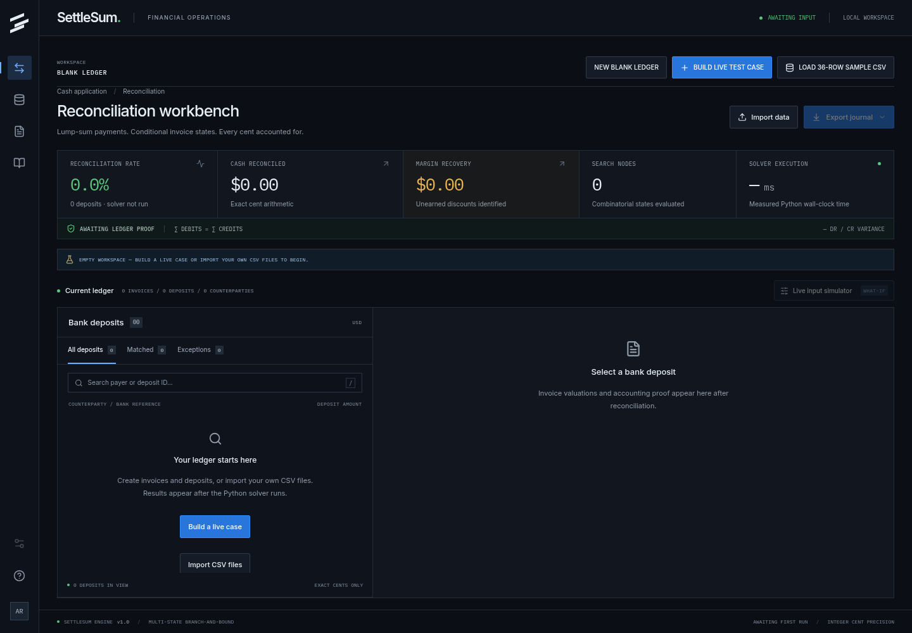
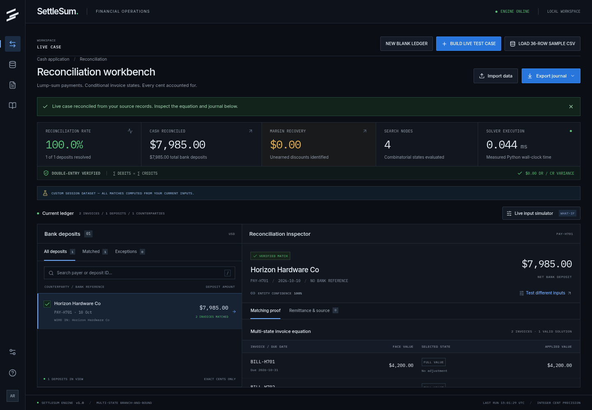

# SettleSum

**B2B cash application, multi-state lump-sum reconciliation, and margin recovery.**

SettleSum reconciles bank deposits to computed combinations of open invoices, including valid early-payment discounts, expired discounts, documented short-pays, and permitted wire fees. Every match includes an exact-cent equation and a verified double-entry journal. The financial terminal starts with an empty ledger and supports an interactive live-case builder, source edits, flexible CSV imports, PDF/text remittances, and accounting exports.

All included business records are **SYNTHETIC BENCHMARK DATA — modeled on B2B wholesale AR ledgers**. No included record represents a real customer transaction.



The initial workspace contains no sample transactions or computed results. See the [workspace verification record](docs/WORKSPACE_VERIFICATION.md).

## Start from zero

The terminal opens with **zero invoices, zero deposits, no remittances, and no computed results**. Reloading starts a new blank session; records are held in browser memory.

- **NEW BLANK LEDGER** clears all source records, results, selected records, and solver settings.
- **+ BUILD LIVE TEST CASE** opens a composer. Enter any customer, add/remove invoice and deposit rows, select invoices for an exact sum preview, and optionally paste a remittance claim. Choose a fresh ledger or append to the current ledger. The exact-sum, $15 wire-fee, and 2% helpers only fill source amounts. **RUN SOLVER ON THIS LEDGER** sends those records to Python; matches, invoice states, telemetry, and journals are returned by the real solver.
- **LOAD 36-ROW SAMPLE CSV** explicitly loads the synthetic benchmark source records and reconciles them from scratch. Samples are never loaded on startup.

**Import data** includes blank invoice/deposit templates and current source-ledger downloads. Download the ledger ZIP, extract its two CSV files, edit them in a spreadsheet, clear the workspace, and import each file. Either import order works: the first file is staged, and reconciliation runs once both invoices and deposits exist. The ZIP also contains remittance JSON as a source backup; attach claims through the PDF/text importer when restoring a ledger.



Actual browser run of a custom test case; solver timing varies.

## Run locally

Requires Python 3.11+ and Node.js 20.19+ (Node 22 recommended).

```bash
python -m venv .venv
source .venv/bin/activate
python -m pip install -r backend/requirements.txt
npm --prefix frontend ci
npm --prefix frontend run build
python -m uvicorn backend.main:app --host 0.0.0.0 --port 8000
```

Open **http://localhost:8000**. FastAPI serves both the built React terminal and API. Interactive API docs are at **http://localhost:8000/docs**.

For development with hot reload:

```bash
bash scripts/dev.sh
```

Open **http://localhost:5173**. Vite proxies `/api` to Python on port 8000. Stop with Ctrl+C. Restart the Python server after creating the first production build so its static mount is registered.

## Deploy to Vercel

Import **Syedsaadhhh/SettleSum** into Vercel with the repository root as the **Root Directory**. The checked-in `vercel.json` selects the custom build (`Other` framework), runs `npm --prefix frontend ci && npm --prefix frontend run build`, serves `frontend/dist`, and routes `/api/*` to `api/index.py`. No API URL, CORS override, database, or API key is required for the default offline workflow.

`api/index.py` adds the project root to Python's import path and exports `backend.main.app`. Root `requirements.txt` includes the backend requirements. The function bundle explicitly includes backend code and benchmark source files. FastAPI imports cleanly without `frontend/dist`; on Vercel, static files are served by the CDN instead of Python.

Optionally add `GEMINI_API_KEY` as a server-side Vercel environment variable to enable Gemini remittance extraction. Never use a `VITE_` prefix for that secret. Without a key, deterministic local parsing remains available. Vercel's function request/response body limit is 4.5 MB, which takes precedence over the local API's larger upload limits. Keep uploaded files and reconciliation JSON below that limit. Search remains bounded by the configured node budget and the platform's execution limits.

These instructions prepare deployment; verification below exercises the local ASGI entry point and browser flows. No hosted deployment is implied by a successful local build.

## Verify

```bash
python scripts/audit_static.py
python -m pytest -q backend/test_hard_pass.py
python -m pytest -q backend
npm --prefix frontend test
npm --prefix frontend run build
```

**66 Python tests and 7 frontend tests** (including all original 54 backend tests) verify the current implementation. The dedicated five-point torture suite verifies the exact alien CSV, a one-cent mutation, earned-to-unearned date changes, double-entry invariants, and offline remittance extraction. See the [historical hard-pass audit report](docs/HARD_PASS_AUDIT.md) and [workspace verification](docs/WORKSPACE_VERIFICATION.md). The suite covers the seven real computed benchmark matches and exception; a removed $15 fee; a one-cent amount edit; a changed clearing date; invoice-date edits; disabled fees; duplicate prevention; empty/negative/malformed input; PDF/text parsing; journal exports; custom fee bands; exact rounding; FIFO/remittance ranking; search budgets; and a 1,200-invoice input. An independent exhaustive oracle checks branch-and-bound results on generated small ledgers. GitHub Actions runs the static source guard, full Python suite, frontend currency tests, and production frontend build on pushes and pull requests.

An optional full-stack browser smoke check is included in `scripts/verify_browser.py`. With Playwright installed and a Chromium executable available, run it against the live server:

```bash
python -m pip install playwright
python scripts/verify_browser.py --url http://localhost:8000 --browser /usr/bin/chromium
python scripts/verify_hard_pass_browser.py --url http://localhost:8000 --browser /usr/bin/chromium
python scripts/verify_workspace_browser.py --url http://localhost:8000 --browser /usr/bin/chromium
```

These checks drive real uploads and API calls. The hard-pass browser script compares telemetry, invoice states, GL cells, and CSV/audit exports after amount/date mutations, wire-fee and discount toggles, custom fee bands, and offline claims. It also checks dataset replacement, keyboard controls, safe-integer rejection, and desktop/mobile overflow. No HTTP responses or computation results are mocked.

## Benchmark

36 open invoices across six synthetic customers, with eight deposits:

| Deposit  | Customer                          |       Cash | Computed valuation                              |
| -------- | --------------------------------- | ---------: | ----------------------------------------------- |
| DEP-9001 | Apex Industrial Supply            | $14,835.00 | $14,850 face − $15 wire fee                     |
| DEP-9002 | Vanguard Medical Systems          | $21,560.00 | $22,000 face − $440 valid discount              |
| DEP-9003 | Kestrel Freight & Logistics       | $18,412.00 | $18,700 face − $164 unearned − $124 earned      |
| DEP-9004 | Northstar Precision Manufacturing |  $9,410.00 | $9,750 face − $340 documented short-pay         |
| DEP-9005 | Meridian Cold Storage             | $11,225.00 | $11,250 face − $25 wire fee                     |
| DEP-9006 | Solstice Building Materials       |  $7,650.00 | Two invoices, exact full value                  |
| DEP-9007 | Apex Industrial Supply            |  $4,890.00 | $5,000 face − $100 earned discount − $10 fee    |
| DEP-9008 | Unknown / Omega Holdings          |  $6,123.45 | Unapplied exception; no forced match or journal |

Baseline: **7/8 deposits**, **$87,982.00** reconciled cash, **$164.00** identified unearned discounts, **$664.00** valid discounts, **$340.00** short-pay disputes, **$50.00** fees, **$0.00** debit/credit variance. Node counts and milliseconds come from each actual run and are never sample constants in the application.

### Live changed-input demo

1. Open **Live input simulator**.
2. Select Vanguard deposit **DEP-9002**.
3. Change clearing date from **2026-10-09** to **2026-10-19**.
4. Click **RE-SOLVE LEDGER**.

Its two discounts retain the same mathematical payment values but move from **GL 4910** to **GL 1215**. Identified recovery rises from **$164.00 to $604.00**. LOAD 36-ROW SAMPLE CSV restores the original source records and runs the solver again.

Changing Apex DEP-9001 from $14,835.00 to $14,850.00 removes the inferred $15 fee. Adding only $0.01 results in an exception under the default fee rules. These outcomes are computed from the submitted records; no deposit ID is a solver instruction.

## How the solver works

`backend/solver.py` implements the multi-state choice branch-and-bound algorithm directly in Python. It has no external subset-sum or optimization dependency.

For each resolved customer and deposit:

1. Exclude already-applied invoices and invoices issued after the clearing date.
2. Generate discrete states per eligible invoice: `FULL`; `EARNED_DISCOUNT` inside its term window; `UNEARNED_DISCOUNT` after that window; and `REMITTANCE_SHORTPAY` when a referenced document supplies a claim.
3. Search subsets of one through `max_subset_size` invoices, choosing at most one state per invoice. Remaining-cardinality face-value upper bounds and the target-plus-fee upper bound prune unreachable branches. Skips are implicit in increasing invoice indices. Recursion depth is bounded by subset size.
4. Accept only exact equality: **sum(selected state values) − permitted wire fee = deposit cents**. A custom band allows every integer-cent fee between its inclusive endpoints; it does not relax the equation.
5. Rank all feasible assignments by explicit remittance hits (descending), sum of state-complexity weights (FULL=0, earned=1, short-pay=2, unearned=3), zero-fee preference, and lexicographic ascending due dates. Fee amount and stable invoice/state/document identifiers break remaining ties. When a documented claim has the same amount as a permitted wire fee, a simpler full-value/fee assignment can outrank the short-pay state under this specified priority; inspect the returned alternatives. Return the best candidate and up to five alternatives, plus the exact candidate count.

Deposits apply in **clearing-date order, then deposit ID**. Matched invoices are reserved once for the run. This is a deterministic per-deposit policy; it is not a global optimization across every possible ordering of an entire bank batch.

Dollar inputs use `int(round(float(value) * 100))` at ingress as specified. Cents inputs accept exact integers. Monetary inputs and ledger totals are constrained to signed 64-bit range. Search uses Python integer arithmetic without overflow or floating-point monetary operations. Discount rates are validated decimals; rational integer arithmetic rounds the selected net amount to cents using round-half-to-even. Use `amount_cents` for large values or direct API integrations that require exact integer ingress. The browser validates all incoming/outgoing monetary numbers against its safe-integer limit (9,007,199,254,740,991 cents) and rejects larger values before applying source data; the Python API retains the full signed-64-bit currency domain. Browser dollar entry and formatting use integer/BigInt scaling, preserving the last cent without floating-point formatting drift.

`perf_counter_ns()` measures actual solver execution, including state-vector construction and bound preparation. A node is one entered search call, including a root or call pruned by bounds. No artificial waiting or simulated telemetry is used. The summary adds each deposit's solver measurements; `request_time_ms` measures the broader reconciliation operation.

### Search limits and exceptions

Defaults: subset size **6**, node budget **2,000,000 per deposit**, entity confidence threshold **0.65**. Accepts up to 2,000 invoices and 500 deposits per request. Subset-size limit is configurable up to 20. Increasing it can make search expensive; branch-and-bound is still combinatorial.

A budget interruption returns **SEARCH_LIMIT**, discards provisional matches, and emits no journal. Unresolved or ambiguous counterparties and impossible exact equations return **UNMATCHED_EXCEPTION**. The engine does not guess a customer from amount alone. Counterparty matching accepts generic token-prefix abbreviations of at least three letters, with ambiguous candidates still routed to review; no customer-specific name branches are used. Search duration depends on source data, configuration, and hardware; sub-5-ms operation is not guaranteed for arbitrary uploads.

## Data import

**Invoice CSV:**

```csv
invoice_id,customer_id,customer_name,invoice_date,due_date,amount_cents,discount_terms,discount_pct,discount_days
CUSTOM-001,CUSTOMER-1,Example Manufacturing,2026-10-01,2026-10-31,100000,2/10 Net 30,0.02,10
```

**Deposit CSV:**

```csv
deposit_id,deposit_date,raw_payer_memo,amount,bank_reference
PAYMENT-001,2026-10-09,ACH EXAMPLE MANUFACTURING,980.00,REFERENCE-01
```

Use ISO dates, unique invoice/deposit IDs, positive amounts, and consistent customer names per customer ID. Either schema accepts dollar `amount` or integer `amount_cents`; explicit cents take precedence when both are supplied. If discount fields are omitted or blank, `2/10 Net 30` terms can supply the rate/window. Explicit rate/window fields take precedence. Only `invoice_id`, `customer_name`, `invoice_date`, and either `amount` or `amount_cents` are required for invoice CSV ingestion. Missing customer IDs derive deterministically from normalized names; missing due dates use Net terms, defaulting to 30 days. Headers are case/space insensitive; aliases include `Invoice Number`, `Customer`, `Invoice Amount`, `Terms`, `Clearing Date`, `Bank Memo`, and `Deposit Amount`. Duplicate canonical headers and malformed rows are rejected.

Importing a CSV replaces that session's selected source dataset. Frontend input changes are held in memory; a browser reload opens a blank ledger. There is no database or external posting integration.

### Remittance extraction

Upload a text-based PDF or UTF-8 TXT, or paste a note such as:

```text
Customer: Example Manufacturing
Applying $25 debit memo DM-101 against INV-EXAMPLE-001 for damaged goods
```

The deterministic offline parser reads explicit invoice IDs and claim amounts. The composer and import drawer provide current invoice IDs as parsing context, so custom IDs and their exact capitalization are preserved. Without context the generic INV/INVOICE pattern is used. Put one invoice claim per line for unambiguous attribution. It does not infer an amount when multiple amounts appear in one segment. Review extracted references before applying. Image-only PDFs require pasted text or a text-based document; OCR is not included.

Set `GEMINI_API_KEY` in the Python process environment to enable optional **Gemini 2.5 Flash** extraction. It falls back to the offline parser on provider errors or invalid output. With a key configured, remittance text is sent to Gemini; without one, extraction is local. `.env.example` documents variables, but `.env` is not loaded automatically. Never commit keys.

## API

| Endpoint                                         | Input                                               | Output                                                                                  |
| ------------------------------------------------ | --------------------------------------------------- | --------------------------------------------------------------------------------------- |
| `GET /api/health`                                | —                                                   | Engine health                                                                           |
| `GET /api/sample-data`                           | —                                                   | Labeled synthetic source records                                                        |
| `POST /api/reconcile`                            | Invoices, deposits, remittances, config             | Computed matches, alternatives, proofs, summary, telemetry                              |
| `POST /api/parse-remittance`                     | JSON text, raw text/PDF, or multipart `file`        | Validated references, parser name, warnings                                             |
| `POST /api/import-csv?kind=invoices`             | Raw UTF-8 CSV body                                  | Validated invoice rows                                                                  |
| `POST /api/import-csv?kind=deposits`             | Raw UTF-8 CSV body                                  | Validated deposit rows                                                                  |
| `POST /api/export-source-csv?kind=ledger`         | Source invoices/deposits/remittances; partial ledgers allowed | ZIP of lossless invoice/deposit CSVs and remittance JSON; `kind=invoices` or `deposits` downloads a single CSV |
| `POST /api/export-journal-csv?vendor=quickbooks` | Reconciliation request                              | QuickBooks journal CSV                                                                  |
| `POST /api/export-journal-csv?vendor=xero`       | Reconciliation request                              | Xero manual journal CSV                                                                 |
| `POST /api/export-audit-json`                    | Reconciliation request                              | Fresh result, source inputs/configuration, source SHA-256, UTC timestamp, and telemetry |
| `POST /api/export-chargebacks-csv`               | Reconciliation request; optional `deposit_id` query | Draft recovery/dispute debit memo summary                                               |

Example request shape:

```json
{
  "invoices": [],
  "deposits": [],
  "remittances": [],
  "config": {
    "allow_wire_fees": true,
    "wire_fee_options_cents": [0, 1000, 1500, 2000, 2500, 3000],
    "wire_fee_band_min_cents": null,
    "wire_fee_band_max_cents": null,
    "allow_discounts": true,
    "max_subset_size": 6,
    "max_nodes": 2000000,
    "entity_match_threshold": 0.65
  }
}
```

Populate the arrays with records; empty ledgers intentionally return structured `422 VALIDATION_ERROR`. Non-solver endpoints report zero solver metrics. All API responses also expose `X-Solver-Time-Ms`, `X-Nodes-Explored`, and measured `X-Request-Time-Ms` headers; CSV responses carry telemetry in these headers. Accounting and audit exports recompute the current request and never trust client-supplied journal lines. Source CSV exports serialize input records without running the solver. The audit JSON’s source hash identifies its canonical inputs; it is not a digital signature.

## Accounting treatment

| GL   | Treatment                                               |
| ---- | ------------------------------------------------------- |
| 1010 | Debit bank cash received                                |
| 6120 | Debit permitted wire fees                               |
| 4910 | Debit valid earned sales discounts                      |
| 1215 | Debit recoverable unearned-discount chargeback AR       |
| 1220 | Debit documented, unapproved short-pay dispute clearing |
| 1200 | Credit face-value AR per matched invoice                |

Each journal must satisfy **∑ debit cents = ∑ credit cents** before it can be returned. Unearned discounts and short-pays generate **draft debit memos for controller review**. “Margin recovery” means identified recoverable AR; it does not mean collected cash. No email, chargeback, journal, or debit memo is sent or posted externally.

QuickBooks exports use journal-import fields; Xero exports use signed manual-journal amounts. Map the sample account names/codes and tax treatment to the target company's chart before importing. Import availability and field requirements depend on the accounting product edition and locale. Draft debit memos are exported separately from balanced journal lines. The inspector’s **Generate debit memo** action exports only the selected deposit’s drafts, after reconciling the entire source batch to preserve invoice allocation. The header export menu exports drafts for the entire ledger.

## Repository

```text
api/index.py              Vercel ASGI entry point
vercel.json               Frontend build, static output, API rewrites
requirements.txt          Root Python dependency entry point
backend/
  csv_io.py               Flexible CSV normalization and source exports
  main.py                 FastAPI, validation, imports, exports, static serving
  models.py               Typed, validated schemas and currency ingress
  solver.py               Multi-state branch-and-bound; exact integer arithmetic
  reconciliation.py       Counterparty isolation and batch allocation
  entity_resolver.py      Deterministic tokens and edit similarity
  remittance_parser.py    PDF/text and optional Gemini extraction
  ledger_exporter.py      Double-entry verification and vendor CSV formats
  test_solver.py          Benchmark, changes, failure cases, oracle checks
  test_hard_pass.py       Five required API torture scenarios
  test_audit_regressions.py  Validation, boundaries, ambiguity, and audit export
  test_workspace.py        CSV round-trips, custom IDs, Vercel entry point
frontend/
  src/App.jsx             Financial operations terminal
  src/components/         Register, proofs, telemetry, simulator, import drawers
sample_data/              Synthetic CSV, JSON, text, and PDF fixtures
scripts/dev.sh            FastAPI + Vite development startup
scripts/audit_static.py   Source red-flag guard
scripts/verify_hard_pass_browser.py  Real end-to-end mutation/export checks
frontend/test/            Exact browser currency tests
```

## License

Copyright (c) 2026 Syedsaadhhh. **Proprietary — all rights reserved.** See [LICENSE](LICENSE). Public source visibility does not grant an open-source license. Third-party packages retain their respective licenses.
